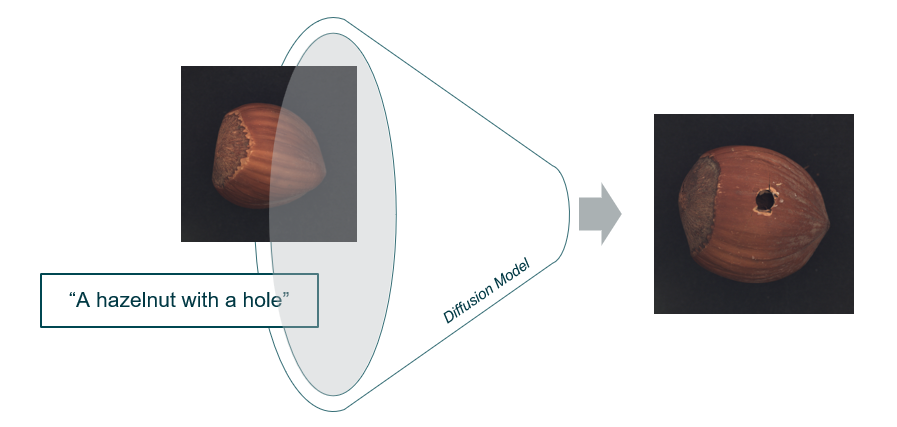

## Industrial Anomaly Synthesis Using Diffusion Models
*Final Degree Project (FDP) \| 2024-2025*

*[GitHub Organization](https://github.com/IndustrialAnomalySynthesis)*

Organization access is available on request via [email](mailto:{{ site.email }}).

{: .project-illustration }

In modern manufacturing production lines (Industry 4.0), predictive Artificial Intelligence (AI) models are used to accurately detect, locate pixel-wise, and classify industrial anomalies in images. These tasks ensure product quality, reduce operational downtime, and maintain safety standards on automated production lines. However, the scarcity of anomalous samples needed to train AI models to perform these tasks represents a persistent challenge in real-life industrial settings.

The main objective of this Final Degree Project (FDP) is to learn and analyze the use of state-of-the-art work to synthetically generate anomalous data. To this end, after an exhaustive classification and analysis of the available literature, the technology best suited to this context has been selected: diffusion models. In this diffusion process, noise is iteratively added and removed from images, thereby learning the ability to generate images from random noise. Among the studies using this technology to generate synthetic anomalies in industrial images, the two most significant were selected: AnomalyDiffusion and DualAnoDiffusion. These two models were then replicated on a new, previously unseen dataset (called VisA) for comparison. This was achieved by analyzing the generated images and using a model for anomaly detection and localization (U-Net), thereby simultaneously measuring the quality of the generated synthetic datasets using several well-known metrics (IS, AP, PRO, F1 Max, and AUROC).

Considering the results obtained, the DualAnoDiffusion study was the one that performed the best. For example, in the "candles" class of the VisA dataset, we observed the following performance differences compared to those obtained for AnomalyDiffusion: 47.68% for the AP-Image metric, 33.6% for the F1-max Image metric, 110.4% for the AP-Pixel metric, and 52.65% for the F1-max-Pixel metric. Furthermore, we observed the difficulties presented by the two works reproduced on previously unseen data, including the generation of anomalies in images with multiple objects and objects with complex structures (electronic plates). Along the way, a synthetic dataset that can be used in future research has been created.
