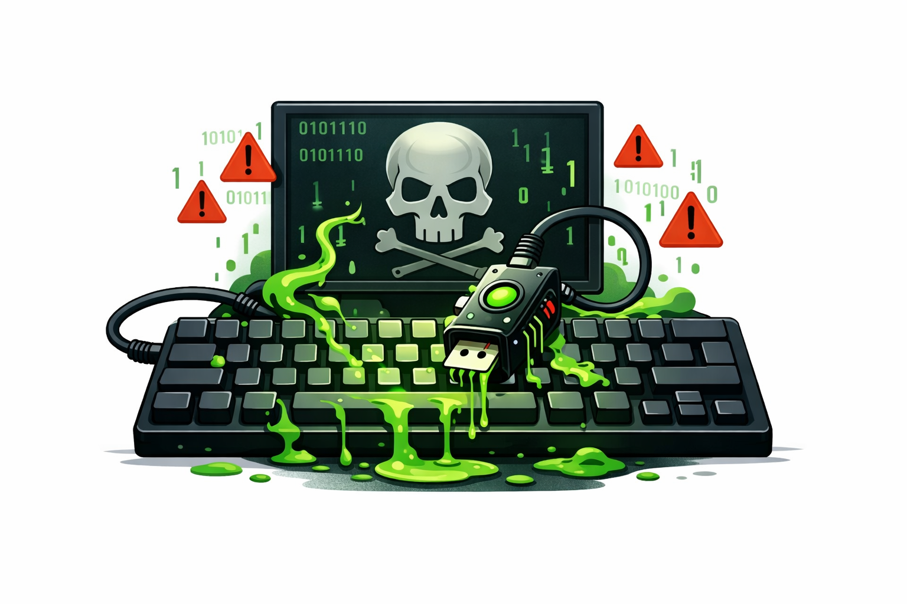

This page highlights personal and independent projects published on my GitHub profile outside my academic work.

## Personal Knowledge Management with Obsidian

*[GitHub Repository](https://github.com/rubiotelmo0/obsidian-vault-template)*

  

A reusable Obsidian vault template built around my personal workflow and philosophy for Personal Knowledge Management (PKM). The repository includes a structured vault layout with notes, templates, diagrams, attachments, and metadata conventions intended to support long-term learning rather than short-lived note storage. It reflects my interest in connected knowledge systems such as atomic notes, maps of content, and evergreen note refinement, where ideas are progressively clarified and linked instead of remaining isolated files.

## Keyboard Poisoning

*[GitHub Repository](https://github.com/rubiotelmo0/keyboard-poisoning)*

  

A didactic ARM32 shellcode project created for controlled software security education on a Raspbian lab environment. The repository documents an end-to-end exploitation exercise built around a deliberately vulnerable program, custom shellcode variants, an exploit script, and step-by-step lab notes for debugging and verification. The goal is educational: to study low-level payload construction, memory corruption workflows, and controlled post-exploitation effects in an isolated environment intended exclusively for authorized experimentation and security study.
